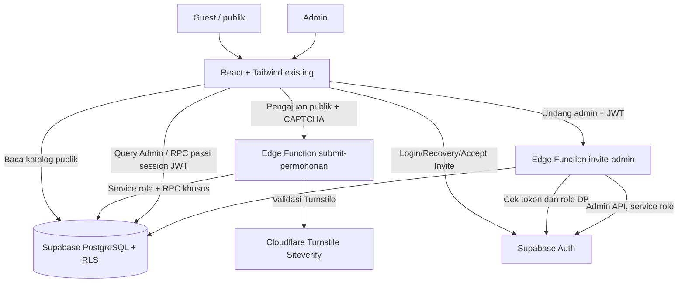
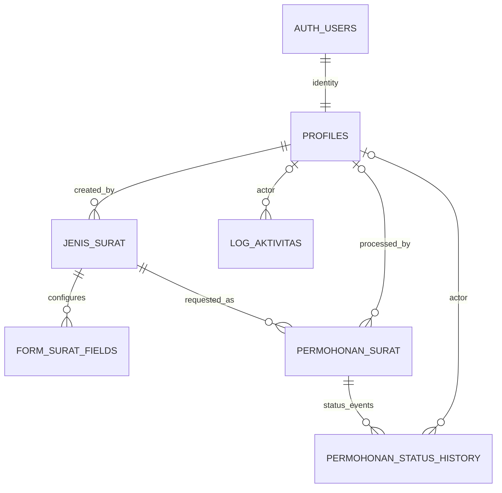

# PRODUCT REQUIREMENTS DOCUMENT (PRD)
## Sistem Pengajuan Surat Online — React JS + Supabase + Tailwind CSS

**Versi:** 1.0  
**Tanggal:** 18 November 2026  
**Sasaran:** AI Coding Agent (Codex/Antigravity/agen lain)  
**Status:** Spesifikasi implementasi MVP. Belum diuji pada instance Supabase nyata.  
**Arsitektur diputuskan:** Guest publik **tanpa login**; **hanya Admin yang login**; **riwayat hanya di Admin**.

---

## 1. Latar belakang dan tujuan

Proyek React JS + Tailwind CSS sudah memiliki tampilan Landing Page Guest, halaman Admin, Dashboard Admin, Permohonan Masuk, Log Aktivitas, Master Jenis Surat, Pengajuan Surat, Login, dan Register. Data masih statis/mock, belum ada desain database, autentikasi aktif, atau CRUD terintegrasi. PRD ini menghubungkan UI **yang sudah ada** ke Supabase dengan perubahan sesedikit mungkin.

**Tujuan keberhasilan:**
1. Guest memilih jenis surat aktif, mengisi form yang sesuai, dan mengirim permohonan tanpa mendaftar akun.
2. Admin masuk melalui Supabase Auth dan hanya Admin aktif yang bisa mengakses halaman administrasi.
3. Admin mengelola master jenis surat dan konfigurasi field formulir (CRUD).
4. Admin memantau permohonan masuk, mengubah status dengan aturan transisi yang tervalidasi, melihat riwayat dan log aktivitas.
5. Data pribadi pemohon tidak pernah dapat dibaca langsung oleh pengguna anonim dari Supabase Data API.
6. Pola folder, component, routing, layout, dan Tailwind existing dipakai ulang.

### 1.1 Ruang lingkup MVP

**Termasuk:** jenis surat, form builder minimal, anonymous submission, admin login, register Admin via undangan, reset password Admin, admin role management, daftar/detail permohonan, filter status/pencarian/pagination, status workflow, audit log, dashboard counts, RLS, dan pengujian akses.

**Tidak termasuk MVP:** akun warga/Guest, login Guest, riwayat Guest, pengecekan status publik, pembayaran, tanda tangan elektronik, unggah berkas, PDF generator, cetak surat otomatis, email/SMS notifikasi pemohon, multi-tenant, hierarki kantor, dan persetujuan berlapis. Semua ini memerlukan keputusan kebutuhan tersendiri; jangan menambahkannya diam-diam.

### 1.2 Asumsi yang ditetapkan agar agen bisa bekerja tanpa menebak

- Nama sistem adalah **Sistem Pengajuan Surat Online** (boleh menggunakan nama branding existing).
- Bahasa UI: Indonesia.
- Data kontak minimal pemohon adalah **nama dan nomor HP**; email opsional.
- Status awal saat Guest menekan Kirim: **menunggu** (tidak ada penyimpanan draft lintas sesi untuk Guest).
- Guest menerima **kode permohonan** sebagai bukti pengiriman; **kode bukan kunci untuk membaca data**, dan tidak ada endpoint cek status publik dalam MVP.
- **Register existing bukan public sign-up**. Halaman tersebut hanya menyelesaikan undangan Admin (buat password), atau menampilkan keterangan bahwa pendaftaran memerlukan undangan.
- Role konseptual: `guest` = akses publik tanpa Supabase Auth; `admin` = pengguna terautentikasi dan aktif. Kolom role pada `profiles` mendukung `guest` untuk akun yang belum dipromosikan/dinonaktifkan dari hak Admin; **tidak membuat akun Guest wajib**.
- Semua akun Admin baru dibuat melalui alur undangan yang disetujui Admin. Admin pertama dibuat manual di Supabase Dashboard dan dipromosikan melalui SQL Editor yang tepercaya.

---

## 2. Stakeholder dan aktor

| Aktor | Perlu login | Hak utama |
|---|---|---|
| Guest / masyarakat | Tidak | Baca jenis surat aktif, baca field publik, isi/kirim permohonan, lihat kode setelah berhasil |
| Admin aktif | Ya | CRUD jenis/field surat, lihat dan proses semua permohonan, lihat riwayat, log, dashboard, undang/kelola Admin |
| Akun dengan role `guest` pada `profiles` | Ya, jika akun pernah diundang/dibuat | Tidak memiliki akses Admin; tidak mendapat hak melihat permohonan |
| Operator Supabase | Akses Dashboard Supabase | Bootstrap Admin pertama, setup secrets/Auth, migrasi, backup |

**Aturan:** route guard pada React hanya pengamanan UX. Akses utama ditegakkan oleh Postgres GRANT, RLS, RPC, dan Edge Functions.

---

## 3. Functional requirements dan acceptance criteria

### FR-01 Landing Page / katalog Guest
- Guest membuka landing page tanpa login.
- Tampilkan jenis surat `is_active = true` saja.
- Setiap jenis memiliki `kode`, `nama`, `deskripsi`.
- Jika suatu jenis belum aktif, jangan menampilkan jenis itu di katalog publik.
- Katalog dan form fields dapat dibaca langsung oleh anon role Supabase melalui RLS.

**AC-01:** Tanpa sesi login, katalog jenis aktif tampil. Jenis nonaktif tidak muncul meskipun URL dipalsukan.

### FR-02 Pengajuan surat oleh Guest (tanpa akun)
1. Guest memilih jenis surat.
2. UI memuat field dari `form_surat_fields`, urut `urutan`.
3. Tampilkan label, placeholder, required, jenis kontrol, dan opsi select.
4. Guest mengisi nama, nomor HP, email opsional, jawaban form.
5. Validasi client-side untuk UX; semua validasi **wajib diulang di server**.
6. Jalankan Cloudflare Turnstile, kirim token + jawaban ke Edge Function `submit-permohonan`.
7. Edge Function memverifikasi CAPTCHA, mengeksekusi RPC tertutup, dan mengembalikan kode permohonan jika berhasil.
8. Tampilkan sukses beserta kode permohonan. Jangan membuat sesi Auth Guest.

**AC-02:** Guest tanpa login dapat submit valid dan mendapat kode; data tersimpan satu kali dengan status `menunggu`.  
**AC-03:** Field wajib kosong, opsi tidak sah, jenis surat nonaktif, atau field ekstra ditolak oleh database.  
**AC-04:** Guest tidak dapat membaca `permohonan_surat` dari Data API, termasuk data miliknya sendiri setelah submit.  
**AC-05:** Service-role key hanya tersedia di Edge Function, tidak di Vite/browser.

### FR-03 Login khusus Admin
- Login email + password via `supabase.auth.signInWithPassword`.
- Setelah Auth berhasil, baca profil sendiri dari `profiles` dan pastikan `role = 'admin'` serta `is_active = true`.
- Non-admin tidak boleh masuk halaman Admin (arah ke halaman akses ditolak atau logout disertai pesan netral).
- Refresh browser tidak menyebabkan dashboard terbuka ke non-admin; tampilkan loading sampai sesi + role selesai diverifikasi.
- Logout menggunakan `supabase.auth.signOut()`.

**AC-06:** Kredensial tidak valid menunjukkan pesan aman, tanpa membocorkan keberadaan email.  
**AC-07:** Akun role `guest` atau `is_active=false` ditolak walaupun password benar.  
**AC-08:** Membuka route `/admin/...` langsung tanpa login dialihkan ke halaman Login; backend tetap menolak query.

### FR-04 Register Admin via undangan
- **Tidak menggunakan public `supabase.auth.signUp`**.
- Admin aktif dapat mengundang admin baru dengan email melalui Edge Function `invite-admin` yang memeriksa JWT dan role pengundang di server.
- Edge Function memanggil Admin API invite via `service_role`, memberi role `admin` pada profil yang dibuat, dan mengaudit undangan.
- Penerima membuka link undangan di `/register` dan menyetel password menggunakan sesi undangan yang sah.
- Akses langsung `/register` tanpa undangan menampilkan keterangan "Pendaftaran Admin memerlukan undangan"; tidak membuka pendaftaran publik.
- Admin pertama di-bootstrap secara manual (lihat bagian 12).

**AC-09:** Visitor tidak bisa membuat akun baru lewat Register publik.  
**AC-10:** Hanya Admin aktif dapat mengundang Admin lain; akses token non-admin ke `invite-admin` ditolak.  
**AC-11:** Penerima undangan valid bisa set password lalu login sebagai Admin.

### FR-05 Lupa Password Admin
- Gunakan `supabase.auth.resetPasswordForEmail(email, {redirectTo: ...})`.
- Halaman `/reset-password` menerima sesi recovery yang sah, lalu `supabase.auth.updateUser({ password })`.
- Tampilkan konfirmasi netral untuk mencegah enumerasi akun.
- Atur Redirect URL yang benar di Supabase Auth.

**AC-12:** Admin dapat meminta email reset dan mengganti password tanpa mengakses profil orang lain.

### FR-06 Manajemen role
- Definisi hanya `admin` dan `guest`.
- Admin dapat melihat daftar profil akun (bukan Guest anonim) dan mengubah role menggunakan RPC `admin_set_role`.
- Tidak boleh update `profiles.role` lewat table endpoint.
- Admin tidak boleh menurunkan role dirinya sendiri melalui RPC.
- Pengubahan role dicatat otomatis pada `log_aktivitas`.
- Halaman role management hanya ditambahkan jika komponen existing belum ada dan penambahan diperlukan untuk memenuhi fitur; jangan redesain dashboard.

**AC-13:** Non-admin tidak dapat mengubah role; admin tidak dapat mengubah role dirinya sendiri menjadi Guest.

### FR-07 CRUD Master Jenis Surat
- Admin: tambah, lihat, ubah, hapus jenis surat (kode, nama, deskripsi, status aktif).
- `kode` unik, huruf kapital/angka/underscore; `nama` wajib.
- Jenis baru default nonaktif. Aktifkan hanya bila konfigurasi form siap.
- Jenis dengan permohonan existing **tidak bisa dihapus permanen** karena FK `RESTRICT`; sediakan aksi nonaktifkan sebagai alternatif.
- Perubahan tertulis ke log audit melalui trigger.

**AC-14:** Guest hanya melihat jenis aktif, Admin melihat semua.  
**AC-15:** Admin bisa CRUD jenis yang belum punya permohonan. Delete jenis yang sudah digunakan ditolak secara aman.

### FR-08 CRUD Form Surat (form builder)
- Admin membuka suatu jenis surat dan mengelola field secara dinamis.
- Field: `field_key`, `label`, `tipe_input`, `placeholder`, `wajib`, `opsi` (khusus select), `panjang_maksimum`, `urutan`.
- Tipe didukung: `text`, `textarea`, `number`, `date`, `select`, `email`, `tel`.
- `field_key` harus unik dalam satu jenis, stabil, dan tidak mengandung spasi.
- Field bisa ditambah/edit/hapus/diurutkan; jangan membuat drag-and-drop baru bila UI existing tidak punya (cukup input urutan atau tombol naik/turun).
- Field `select` wajib mempunyai opsi; selain `select`, opsi kosong.
- Perubahan konfigurasi tidak mengubah jawaban dan snapshot permohonan historis.

**AC-16:** Field jenis A tidak muncul dalam form jenis B.  
**AC-17:** Setelah form builder diubah, snapshot permohonan lama tetap dapat dirender oleh Admin.

### FR-09 Permohonan masuk (Admin)
- Tabel/list permohonan berisi kode, nama pemohon, jenis surat, tanggal kirim, status.
- Filter status, jenis surat, pencarian nama/kode, urut terbaru, pagination sesuai pola existing.
- Detail permohonan menampilkan biodata, jawaban berdasarkan `snapshot_form`, status, catatan admin, dan timeline.
- Admin tidak dapat menulis ulang jawaban pemohon setelah submit.
- Admin mengubah status hanya lewat RPC `admin_change_status`.

**AC-18:** Admin bisa membuka detail semua permohonan, Guest tidak bisa.  
**AC-19:** Transisi status tidak sah ditolak database.  
**AC-20:** Penolakan wajib alasan; aksi status tercatat sebagai riwayat dan audit.

### FR-10 Riwayat permohonan (hanya Admin)
- Berupa tabel semua permohonan (termasuk selesai/ditolak) dan timeline riwayat per permohonan.
- Status terminal tetap tersimpan; tidak ada fitur hapus dari UI MVP.
- Tidak tersedia menu riwayat untuk Guest.

**AC-21:** Admin dapat menelusuri riwayat status berurutan; Guest tidak dapat membacanya.

### FR-11 Log Aktivitas
- Admin melihat aktivitas master jenis surat, form fields, undangan/perubahan role, submit Guest dan perubahan status.
- Audit hanya menyimpan metadata seperlunya; jangan menyalin nomor HP, NIK, atau jawaban form lengkap ke `log_aktivitas`.
- Log tidak bisa di-insert/update/delete langsung dari frontend.

**AC-22:** Operasi penting menghasilkan log dan non-admin tidak bisa mengakses daftar log.

### FR-12 Dashboard Admin
- Dashboard mengambil jumlah keseluruhan, per status, dan terbaru dari data nyata.
- Gunakan query agregasi sederhana atau `.select('id', { count: 'exact', head: true })` dengan filter status.
- Pertahankan desain card/chart existing; jangan tambah library chart tanpa alasan.

**AC-23:** Angka dashboard berubah setelah submit atau perubahan status berhasil.

---

## 4. Status permohonan dan transisi bisnis

| Status | Arti | Transisi yang diizinkan |
|---|---|---|
| `menunggu` | Baru dikirim Guest | `diproses`, `ditolak` |
| `diproses` | Admin sedang memeriksa | `disetujui`, `ditolak` |
| `disetujui` | Admin menyetujui | `selesai` |
| `ditolak` | Ditolak dengan alasan | Terminal, tidak ada transisi |
| `selesai` | Proses selesai | Terminal, tidak ada transisi |

- Perubahan status dipastikan secara **atomik** (row lock `FOR UPDATE` + update + insert history + audit dalam satu transaction/function).
- Penolakan (`ditolak`) membutuhkan `catatan` tidak kosong.
- `catatan_admin` pada permohonan mencerminkan catatan aksi terbaru. Detail riwayat tetap disimpan lengkap di `permohonan_status_history`.
- Untuk perubahan aturan status di masa depan, revisi PRD, migrasi database, dan tes transisi terlebih dahulu.

---

## 5. Arsitektur teknis



**Sederhana tapi aman:** frontend tetap React langsung ke Supabase untuk data katalog dan transaksi Admin yang dilindungi RLS; gunakan Edge Function hanya untuk *anonymous write* dan *admin invitation* yang membutuhkan secret privileges. Tidak perlu Express, ORM, dan server Node tambahan.

### 5.1 Ketergantungan minimal
- `@supabase/supabase-js` v2 (sesuaikan dengan yang terpasang).
- React Router **hanya jika project sudah memakai**; bila memakai routing lain, pertahankan.
- Tailwind existing, tanpa mengganti token warna.
- Cloudflare Turnstile widget client + Siteverify server; token wajib diverifikasi di Edge Function.
- Supabase CLI untuk migrasi dan deploy Edge Functions.

### 5.2 Konfigurasi environment

**Frontend (`.env.local`, nilai publik saja):**
- `VITE_SUPABASE_URL`
- `VITE_SUPABASE_ANON_KEY` atau publishable key
- `VITE_TURNSTILE_SITE_KEY`

**Edge secrets (tidak boleh dibundle ke React):**
- `SUPABASE_SERVICE_ROLE_KEY`
- `TURNSTILE_SECRET_KEY`
- `ALLOWED_ORIGINS`
- `ALLOWED_HOSTNAMES`
- `ADMIN_REGISTRATION_URL`

Jangan menaruh `service_role` atau secret CAPTCHA di `.env` yang terbaca Vite (`VITE_*`), repositori publik, maupun client bundle.

### 5.3 Struktur file yang disarankan

**Wajib audit proyek dulu.** Lokasi berikut adalah contoh, **bukan perintah mengganti struktur**:

```text
src/
  lib/supabaseClient.js           # jika belum ada
  ...existing routes/layout/pages # pertahankan nama dan lokasi existing
supabase/
  migrations/001_initial_schema.sql
  functions/submit-permohonan/index.ts
  functions/invite-admin/index.ts
  config.toml                      # tambah section function saja
```

Service/hooks baru dibuat bila memang mengurangi duplikasi; jangan membuat lapisan repository/service/store berlebihan untuk aplikasi MVP.

---

## 6. Desain database (data dictionary)

### 6.1 `auth.users` (disediakan Supabase Auth)
- Tidak dibuat manual dan tidak dimodifikasi strukturnya.
- Satu baris mencerminkan satu akun login Admin/calon Admin.
- `public.profiles.id` mereferensi `auth.users.id`.

### 6.2 `public.profiles`

| Kolom | Type | Aturan |
|---|---|---|
| `id` | uuid PK | FK ke `auth.users.id`, `ON DELETE CASCADE` |
| `email` | text | Untuk display, bukan sumber keputusan otorisasi |
| `nama` | text nullable | Nama tampil Admin |
| `role` | text | `admin` atau `guest`, default `guest` |
| `is_active` | boolean | Default `true`, hanya Admin aktif boleh mengelola |
| `created_at` | timestamptz | Default now() |
| `updated_at` | timestamptz | Ter-update otomatis |

`profiles` dibuat lewat trigger saat Auth membuat user. **Role tidak berasal dari `user_metadata` yang bisa dipengaruhi client**. Role harus dipromosikan dengan operasi tepercaya (operator bootstrap, admin RPC, atau Edge invite-admin).

### 6.3 `public.jenis_surat`

| Kolom | Type | Aturan |
|---|---|---|
| `id` | uuid PK | `gen_random_uuid()` |
| `kode` | text | Unique, format `^[A-Z][A-Z0-9_]{1,29}$` |
| `nama` | text | Wajib, 3–120 karakter |
| `deskripsi` | text nullable | Penjelasan |
| `is_active` | boolean | Default false; hanya yang true publik |
| `created_by` | uuid FK nullable | `profiles.id`, `ON DELETE SET NULL` |
| `created_at`, `updated_at` | timestamptz | Audit waktu |

### 6.4 `public.form_surat_fields`

| Kolom | Type | Aturan |
|---|---|---|
| `id` | uuid PK | ID field |
| `jenis_surat_id` | uuid FK | `jenis_surat.id`, `ON DELETE CASCADE` |
| `field_key` | text | Key jawaban JSON; unik per jenis; `^[a-z][a-z0-9_]{0,49}$` |
| `label` | text | Label tampilan |
| `tipe_input` | text | `text`, `textarea`, `number`, `date`, `select`, `email`, `tel` |
| `placeholder` | text nullable | Placeholder |
| `wajib` | boolean | Default false |
| `opsi` | text[] | Hanya untuk select, minimal 1 opsi |
| `panjang_maksimum` | integer | 1–2000 (default 255) |
| `urutan` | integer | Default 0, >= 0 |
| `created_at`, `updated_at` | timestamptz | Audit waktu |

**Contoh:** jenis surat `SK_DOMISILI` punya `nama_lengkap` (text required), `alamat` (textarea required), `tanggal_lahir` (date required). Data jawaban tersimpan `{ "nama_lengkap": "...", "alamat": "...", "tanggal_lahir": "2026-01-01" }`.

**Penting:** `nama_pemohon` dan `no_hp` adalah metadata kontak wajib yang terpisah dari field dinamis. Hindari menambahkan field redundan tanpa pertimbangan UX.

### 6.5 `public.permohonan_surat`

| Kolom | Type | Aturan |
|---|---|---|
| `id` | uuid PK | ID internal |
| `kode_permohonan` | text UNIQUE | `SUR-` + 16 hex acak, hanya bukti pengajuan |
| `jenis_surat_id` | uuid FK | `jenis_surat.id`, `ON DELETE RESTRICT` |
| `nama_pemohon` | text | Wajib |
| `no_hp` | text | Wajib, 8–20 karakter sesuai format |
| `email` | text nullable | Opsional |
| `jawaban` | jsonb | Object key/value dari formulir; maksimum 32 KB dalam RPC |
| `snapshot_form` | jsonb | Array metadata field saat diajukan; immutable dari UI |
| `status` | text | `menunggu`, `diproses`, `disetujui`, `ditolak`, `selesai` |
| `catatan_admin` | text nullable | Catatan terbaru |
| `diproses_oleh` | uuid FK nullable | `profiles.id`, `ON DELETE SET NULL` |
| `created_at`, `updated_at` | timestamptz | Audit waktu |

**Kenapa JSONB?** Tiap jenis surat mempunyai field berbeda; menggunakan JSONB untuk nilai isian menghindari membuat tabel baru per jenis. `snapshot_form` memastikan label/opsi/form lama tetap sesuai ketika admin menyunting master form. `jawaban` tidak dapat diubah melalui frontend setelah submission.

### 6.6 `public.permohonan_status_history`

| Kolom | Type | Aturan |
|---|---|---|
| `id` | bigint identity PK | ID event |
| `permohonan_id` | uuid FK | `permohonan_surat.id`, `ON DELETE CASCADE` |
| `status_sebelumnya` | text nullable | NULL untuk event awal |
| `status_baru` | text | Status baru |
| `catatan` | text nullable | Alasan/keterangan |
| `actor_id` | uuid FK nullable | Admin yang mengubah; NULL untuk submission Guest |
| `created_at` | timestamptz | Waktu event |

### 6.7 `public.log_aktivitas`

| Kolom | Type | Aturan |
|---|---|---|
| `id` | bigint identity PK | Event audit |
| `actor_id` | uuid FK nullable | NULL untuk submit Guest/aksi sistem |
| `aksi` | text | `insert`, `update`, `delete`, `submitted`, `status_changed`, `role_changed`, `admin_invited` |
| `entitas` | text | Nama sumber perubahan |
| `entitas_id` | text nullable | PK entitas sebagai teks |
| `detail` | jsonb | Metadata yang diminimalkan, bukan PII penuh |
| `created_at` | timestamptz | Waktu event |

### 6.8 Relasi (ERD)



**FK delete policies:** Hapus Auth user menghapus profil; referensi riwayat admin di-set NULL, bukan menghapus data permohonan. Hapus jenis dengan permohonan ditolak (`RESTRICT`). Hapus jenis tanpa permohonan menghapus konfigurasi field (`CASCADE`). Permohonan tidak memiliki fitur delete lewat UI sehingga timeline tidak hilang.

---

## 7. Row Level Security (RLS)

### 7.1 Matrix akses yang harus berlaku

| Tabel/operasi | `anon` Guest | `authenticated` role `guest` | `authenticated` Admin aktif | Edge service role |
|---|---|---|---|---|
| `profiles` SELECT | Tidak | Hanya milik sendiri | Semua | Operasional internal |
| `profiles` INSERT/UPDATE/DELETE langsung | Tidak | Tidak | Tidak | Bootstrapping/invite |
| `jenis_surat` SELECT | Aktif saja | Aktif saja | Semua | Internal |
| `jenis_surat` INSERT/UPDATE/DELETE | Tidak | Tidak | Ya | Internal |
| `form_surat_fields` SELECT | Jenis aktif saja | Jenis aktif saja | Semua | Internal |
| `form_surat_fields` INSERT/UPDATE/DELETE | Tidak | Tidak | Ya | Internal |
| `permohonan_surat` SELECT | Tidak | Tidak | Semua | Internal |
| `permohonan_surat` direct INSERT/UPDATE/DELETE | Tidak | Tidak | Tidak | Hanya operasi tepercaya |
| `permohonan_status_history` SELECT | Tidak | Tidak | Semua | Internal |
| `permohonan_status_history` direct write | Tidak | Tidak | Tidak | Hanya operasi tepercaya |
| `log_aktivitas` SELECT | Tidak | Tidak | Semua | Internal |
| `log_aktivitas` direct write | Tidak | Tidak | Tidak | Operasi tepercaya |
| RPC `submit_public_application` | Tidak | Tidak | Tidak | Ya, hanya Edge Function |
| RPC `admin_change_status` | Tidak | Gagal pemeriksaan role | Ya | Operasional internal |
| RPC `admin_set_role` | Tidak | Gagal pemeriksaan role | Ya | Operasional internal |

### 7.2 Desain helper dan pencegahan eskalasi

- Helper `app_private.is_admin()` adalah `SECURITY DEFINER`, membaca `profiles` secara aman, memeriksa `auth.uid()`, `role='admin'` dan `is_active=true`.
- Schema `app_private` **tidak dimasukkan ke Exposed Schemas PostgREST**.
- Fungsi `SECURITY DEFINER` memakai `SET search_path = ''` dan nama tabel fully qualified.
- Semua fungsi RPC secara eksplisit melakukan `REVOKE` dan `GRANT EXECUTE`; jangan mengandalkan default function grants.
- `anon` tidak mendapat GRANT SELECT pada data permohonan. **RLS saja tidak menggantikan izin tabel**.
- React tidak pernah membaca secret; Supabase Auth `user_metadata` tidak menjadi sumber role.
- Proteksi Admin di browser menggunakan session + role DB, bukan string localStorage.

### 7.3 Kenapa Guest tidak diberi policy INSERT?

Akses publik ke tabel permohonan rawan: siapa pun dapat mengirim permohonan palsu tanpa melewati validasi form dan CAPTCHA, walaupun RLS `WITH CHECK` diterapkan. Karena Guest tanpa identitas, RLS tidak dapat membedakan pengunjung sah dari bot berdasarkan `auth.uid()`. Oleh karena itu:

1. Guest hanya membaca tabel katalog yang non-pribadi.
2. Guest submit via Edge Function publik.
3. Edge memverifikasi Turnstile di server dan memeriksa bentuk input.
4. Edge memakai service-role untuk menjalankan `submit_public_application`, RPC yang sudah membatasi schema dan memvalidasi seluruh field sesuai konfigurasi DB.
5. RPC meng-insert permohonan, status awal, dan audit dalam satu transaksi.
6. Edge mengembalikan **hanya kode dan status**; jangan membocorkan row PII seluruhnya.

**Pengamanan tambahan sebelum production:** rate limiting per sumber request melalui gateway/WAF atau limiter server-side yang memakai identitas jaringan dari header terpercaya, monitoring error/volume submission, batas ukuran request, dan kebijakan retensi data. CAPTCHA mengurangi spam tetapi tidak menjamin semua penyalahgunaan hilang. Origin/CORS bukan kontrol autentikasi.

### 7.4 Pengujian RLS wajib

Test melalui aplikasi/sesi pengguna nyata atau integration test dengan JWT berbeda; **jangan menilai RLS hanya dari SQL Editor** karena SQL Editor menjalankan perintah dengan privilege tinggi.

- Guest tanpa sesi: SELECT jenis aktif ✅; nonaktif ❌; SELECT daftar permohonan ❌; INSERT direct permohonan ❌.
- Auth user role guest: tidak dapat membuka data Admin dan tidak bisa RPC ubah status/role.
- Admin: SELECT semua jenis, field, permohonan, riwayat, log ✅; CRUD katalog ✅.
- Admin: UPDATE langsung pada permohonan ❌; RPC status valid ✅; status invalid ❌.
- Guest: submit dengan CAPTCHA valid ✅; tanpa CAPTCHA ❌.
- Client: menambahkan `role: 'admin'` ke user metadata/JSON ❌, tidak mengubah hak akun.
- Auth invite: non-admin memanggil fungsi invite ❌.
- Browser: `service_role`/`TURNSTILE_SECRET_KEY` tidak muncul dalam network payload atau hasil build.

---

## 8. Desain API / Integrasi React

### 8.1 Read katalog (langsung Supabase)

```js
const { data: jenisSurat, error } = await supabase
  .from('jenis_surat')
  .select('id, kode, nama, deskripsi')
  .eq('is_active', true)
  .order('nama');

const { data: fields } = await supabase
  .from('form_surat_fields')
  .select('id, field_key, label, tipe_input, placeholder, wajib, opsi, panjang_maksimum, urutan')
  .eq('jenis_surat_id', selectedJenisId)
  .order('urutan');
```

### 8.2 Submit Guest

`POST /functions/v1/submit-permohonan` (Edge Function tanpa auth user JWT)

```json
{
  "jenis_surat_id": "<UUID-JENIS-SURAT>",
  "nama_pemohon": "Nama Pemohon",
  "no_hp": "081234567890",
  "email": "pemohon@example.com",
  "jawaban": { "alamat": "Jalan Contoh", "jumlah_tanggungan": 2 },
  "turnstile_token": "<ONE_TIME_TURNSTILE_TOKEN>"
}
```

Success `201`:

```json
{
  "success": true,
  "permohonan": {
    "id": "<UUID-PERMOHONAN>",
    "kode_permohonan": "SUR-<16_HEX>",
    "status": "menunggu"
  }
}
```

`400` formulir/token salah, `403` origin tidak diizinkan (defense in depth), `405` metode salah, `503` server belum siap / captcha unavailable. Jangan return nomor HP/jawaban pemohon pada response.

### 8.3 Login Admin

```js
const { data, error } = await supabase.auth.signInWithPassword({ email, password });
// Baca profiles milik sendiri dan pastikan role === 'admin' && is_active === true.
// Tunda render dashboard sampai validasi selesai.
```

### 8.4 Lupa password Admin

```js
await supabase.auth.resetPasswordForEmail(email, {
  redirectTo: `${window.location.origin}/reset-password`,
});
// Halaman reset-password menerima sesi recovery, lalu:
await supabase.auth.updateUser({ password: newPassword });
```

### 8.5 Invite/Register Admin

- UI Admin memanggil `supabase.functions.invoke('invite-admin', { body: {email} })` dengan JWT Admin.
- Edge memeriksa Auth JWT + role aktif dari DB dan mengundang user melalui Supabase Auth Admin API.
- Halaman `/register` hanya menyetel password bila sesi undangan terverifikasi.
- Jangan pernah memanggil `supabase.auth.admin.*` langsung dari browser.

### 8.6 CRUD Master

Gunakan `supabase.from('jenis_surat').insert/update/delete`, serta `supabase.from('form_surat_fields')` untuk field. RLS memastikan hanya Admin. Tangani pesan konflik unique, FK restrict, loading state, dan success toast sesuai pola UI yang sudah ada.

### 8.7 Ubah status Admin

```js
const { error } = await supabase.rpc('admin_change_status', {
  p_permohonan_id: selectedId,
  p_status_baru: 'diproses',
  p_catatan: 'Dokumen sedang diperiksa',
});
```

### 8.8 Kelola role Admin

```js
await supabase.rpc('admin_set_role', {
  p_user_id: targetUserId,
  p_role: 'guest',
});
```

### 8.9 Admin list + pagination

Query list memakai `.select('id,kode_permohonan,nama_pemohon,created_at,status,jenis_surat_id', {count:'exact'})`, `.order('created_at',{ascending:false})`, `.range(offset,offset+pageSize-1)`; gunakan query detail terpisah untuk `jawaban` dan `snapshot_form`. Filter dan search dibatasi ke kolom yang diperlukan; pakai query-builder Supabase, jangan bangun raw SQL dari string input pengguna.

---

## 9. Ketentuan UI dan non-functional requirements

### 9.1 Perlindungan UI existing (non-negotiable)
- Audit routing, components, styling, naming, existing API mocks terlebih dahulu.
- Jangan menghapus halaman atau mengganti router/libraries kecuali ada alasan teknis terverifikasi.
- Gunakan layout Admin, form components, tables, badges, modal, notifications existing.
- Ubah data source dari mock menjadi Supabase; pertahankan ukuran, warna, spacing, urutan visual yang sudah ada.
- Halaman yang tidak terkait (misalnya landing section non-form) tidak boleh diubah.
- Tambahkan halaman reset-password hanya jika belum ada, dengan gaya halaman login existing.
- Register diubah secara **fungsional** menjadi invite acceptance; penampilan existing tetap sedekat mungkin.
- UI Guest tidak menampilkan login sebagai prasyarat pengajuan; link login boleh tetap ada untuk Admin bila sudah ada.

### 9.2 Keamanan dan privasi
- HTTPS di production.
- Secret management di Supabase, bukan frontend.
- Minimal data PII: nama, kontak, data formulir; jangan tambahkan NIK/foto KTP jika belum diperlukan.
- Riwayat dan log tetap dibatasi Admin; audit log tidak merekam jawaban lengkap.
- Tidak ada write anonim langsung pada tabel data privat.
- CAPTCHA server-side wajib; trusted hostname allowlist, origin allowlist, ukuran payload.
- Setelan Supabase Auth: nonaktifkan public sign-up dan atur Redirect URLs undangan/recovery.
- Terapkan rate limiting + alert lonjakan pengajuan sebelum go-live.
- Tentukan kebijakan backup, masa retensi, dan penghapusan data sesuai ketentuan organisasi sebelum mengolah data riil.

### 9.3 Performa dan UX
- List admin menggunakan pagination di database, tidak mengambil seluruh tabel sekaligus.
- Status loading, empty-state, error feedback ditampilkan tanpa memecah UI.
- Hindari request berulang tak perlu; saat mutasi berhasil, refetch query terkait.
- Gunakan index SQL untuk status, created_at, jenis surat, dan history.
- Jangan logging data sensitif ke console production.

### 9.4 Batasan operasional
- Tidak ada realtime subscription wajib pada MVP; refetch saat navigasi/refresh sudah cukup.
- Deployment frontend bebas mengikuti hosting existing. Database, Auth, dan functions berada di Supabase.
- Tidak memerlukan Node server yang berjalan terus.

---

## 10. Rencana implementasi bertahap (wajib sesuai urutan)

### Fase 0 — Audit kode existing
**Tugas:** baca `package.json`, struktur folder, routes, pages Admin/Guest, styling Tailwind, komponen table/form, mock data, pola state/data fetching.  
**Output:** daftar file yang relevan, dependency existing, rencana file yang akan dimodifikasi, risiko benturan.  
**Gate:** tidak mengubah apa pun sebelum memahami pola proyek. Tidak boleh rewrite total.

### Fase 1 — Supabase project, migrasi, RLS
**Tugas:** sediakan `.env.example`, jalankan `001_initial_schema.sql` di lingkungan development kosong; cek 6 tabel, 3 RPC utama, triggers, indexes, policies. Konfigurasi `auth.users`/profile.  
**Output:** skema dengan hubungan dan RLS aktif; bukti uji anon vs admin.  
**Gate:** no auth Guest can read private tables; query publik hanya katalog aktif.

### Fase 2 — Auth khusus Admin, undangan, reset password
**Tugas:** bootstrap admin pertama, konfigurasi Auth URL, login, logout, role guard, invite-admin, register invitation acceptance, forgot password/reset password.  
**Output:** Admin aktif dapat masuk, akun lain tidak bisa.  
**Gate:** public signup tidak ada; role tidak berasal dari client; register hanya invitation.

### Fase 3 — CRUD jenis surat dan form builder
**Tugas:** sambungkan Master Jenis Surat dan form surat existing ke tabel; validasi `kode`, jenis field, opsi, urutan, aktif/nonaktif.  
**Output:** jenis dan form bisa dikelola admin; publik hanya melihat aktif.  
**Gate:** data tersimpan di DB, bukan localStorage/mock; UI existing tetap.

### Fase 4 — Pengajuan Guest tanpa login
**Tugas:** tampilkan jenis aktif, render form dinamis, kumpulkan kontak, pasang Turnstile, deploy `submit-permohonan` dan panggil RPC; sukses tampil kode.  
**Output:** Guest mengirim permohonan tanpa akun.  
**Gate:** semua validasi server jalan dan submit langsung ke DB ditolak.

### Fase 5 — Permohonan Masuk, Riwayat, Dashboard Admin
**Tugas:** list filter/pagination, detail `jawaban` + `snapshot_form`, status RPC, timeline, total/dashboard counts.  
**Output:** seluruh proses operasional Admin berjalan.  
**Gate:** transisi status invalid ditolak, history utuh; permohonan terminal tidak dihapus.

### Fase 6 — Log aktivitas, role management, QA, hardening
**Tugas:** sambungkan log, kelola role, audit trigger, uji semua policy, form validation, konflik delete, reset password, testing dua akun, CAPTCHA, input invalid, error cases; konfigurasi rate limiting, backup/monitoring.  
**Output:** aplikasi lulus acceptance criteria dan siap ditinjau sebelum go-live.  
**Gate:** tidak ada secret di browser; RLS diuji via JWT yang realistis; regresi UI lulus.

**Definisi selesai per fase:** fitur bisa didemonstrasikan, error ditangani, data tersimpan benar, pengujian hak akses lulus, perubahan file terbatas, dan agent memberikan daftar file/konfigurasi yang berubah.

---

## 11. Test matrix ringkas (minimum sebelum rilis)

| ID | Skenario | Expected |
|---|---|---|
| T01 | Guest membuka landing | Sukses tanpa login |
| T02 | Guest katalog jenis aktif | Muncul |
| T03 | Guest katalog jenis nonaktif | Tidak muncul |
| T04 | Guest kirim valid dengan CAPTCHA | 201, kode dan status menunggu |
| T05 | Guest kirim tanpa CAPTCHA | Ditolak |
| T06 | Guest kirim JSON berisi field ekstra | Ditolak oleh RPC |
| T07 | Guest kirim required kosong | Ditolak |
| T08 | Guest submit pada jenis nonaktif | Ditolak |
| T09 | Guest query tabel permohonan langsung | Tidak ada akses |
| T10 | Guest query log/history/profiles | Tidak ada akses |
| T11 | Guest akses `/admin` | Dialihkan login |
| T12 | Login Admin valid | Dashboard tampil |
| T13 | Login password salah | Pesan error aman |
| T14 | Sesi Auth dengan role guest | Tidak bisa dashboard |
| T15 | Role Admin tetapi is_active=false | Tidak bisa dashboard/data |
| T16 | Non-admin panggil admin RPC | Ditolak |
| T17 | Admin CRUD jenis | Sukses |
| T18 | Admin delete jenis yang dipakai permohonan | FK menolak |
| T19 | Admin CRUD field | Form Guest ikut berubah |
| T20 | Form changed setelah submission | Detail historis tetap render snapshot |
| T21 | Admin perubahan status valid | Status + riwayat + log berubah atomik |
| T22 | Admin status invalid | Ditolak, tidak ada event palsu |
| T23 | Admin tolak tanpa alasan | Ditolak |
| T24 | Guest baca riwayat Admin | Ditolak |
| T25 | Admin reset password | Berhasil lewat recovery session |
| T26 | Public membuka Register tanpa invite | Tidak bisa signup |
| T27 | Admin invite email | Admin baru bisa mengaktivasi password |
| T28 | Role guest mencoba invite Admin | Ditolak |
| T29 | Admin demote diri sendiri | Ditolak |
| T30 | Browser bundle berisi service-role secret | **Wajib tidak ditemukan** |
| T31 | Pengajuan duplikat/back-to-back | Tidak terjadi kebocoran data; limiter operasional berlaku |
| T32 | UI halaman tak terkait | Tidak mengalami regresi |

---

## 12. Setup Supabase langkah demi langkah

1. Buat Supabase project development baru.
2. Jalankan **seluruh** file `supabase/migrations/001_initial_schema.sql` melalui SQL Editor. Ini migration initial non-idempotent, **jangan run ulang tanpa reset**.
3. Buka Database > Tables; cek `profiles`, `jenis_surat`, `form_surat_fields`, `permohonan_surat`, `permohonan_status_history`, `log_aktivitas`.
4. Cek RLS enabled dan policies tiap tabel. Pastikan schema `app_private` tidak ditambahkan ke daftar *Exposed Schemas* API.
5. Di Supabase Auth, **nonaktifkan public signup** (pengaturan dapat berganti nama di UI). Atur Site URL dan Redirect URLs untuk `/register` dan `/reset-password`. Konfigurasi SMTP untuk email undangan/reset production.
6. Bootstrap Admin awal: tambahkan user email/password melalui **Supabase Dashboard > Authentication > Users** (operator berprivilege). Ambil UUID user.
7. Di SQL Editor jalankan (ganti placeholder):
   ```sql
   UPDATE public.profiles SET role = 'admin'
   WHERE id = 'UUID-ADMIN-YANG-DIBUAT';

   SELECT id, email, role, is_active
   FROM public.profiles WHERE role = 'admin';
   ```
8. Isi `.env.local` frontend dengan URL + anon/publishable key + Turnstile site key (public).
9. Konfigurasi secrets Functions: `TURNSTILE_SECRET_KEY`, `ALLOWED_ORIGINS`, `ALLOWED_HOSTNAMES`, `ADMIN_REGISTRATION_URL`. `SUPABASE_SERVICE_ROLE_KEY` merupakan nilai server-side yang disediakan/diatur untuk Edge Function; pastikan bisa diakses runtime tapi **tidak frontend**.
10. Tambahkan dua section dari `supabase/config.example.toml` ke `supabase/config.toml`; deploy fungsi `submit-permohonan` dan `invite-admin`.
11. Uji panggilan dari frontend development URL, pastikan Turnstile hostname lokal dikonfigurasi dengan benar di lingkungan pengembangan.
12. Buat satu jenis surat dan minimal satu field lewat Admin, aktifkan, lalu kirim permohonan Guest; cek Admin menerima data dan dapat mengubah status.
13. Uji anon vs Admin langsung melalui browser/PostgREST dengan JWT yang sesuai, bukan hanya SQL Editor.
14. Jangan go-live sebelum pengetesan keamanan, rate limiting, backup dan kebijakan data pribadi selesai.

**Catatan penting:** terdapat banyak detail konfigurasi Supabase yang bisa berubah menurut versi dashboard. Agen harus memeriksa dokumentasi resmi pada saat implementasi, terutama undangan email, recovery redirect, Edge Function `verify_jwt`, publishable keys, dan secrets.

---

## 13. Instruksi eksplisit untuk AI Coding Agent

> **Sumber kebenaran:** gunakan dokumen PRD ini dan SQL dalam paket. Jangan menebak struktur repo yang belum diperiksa.
>
> 1. Mulai dengan audit source code existing; identifikasi route, pages, components, styles, dan state management yang sudah ada.
> 2. **Jangan menghapus, mendesain ulang, atau memigrasi proyek ke framework lain.**
> 3. Jangan ubah UI halaman tidak terkait; jangan install library UI baru jika komponen existing cukup.
> 4. Implementasikan **satu fase dalam satu waktu** dan laporkan file yang berubah, alasan perubahan, hasil test, dan masalah yang masih ada.
> 5. Guest **tanpa login**, Admin **wajib login**; jangan menambahkan auth Guest atau public signup.
> 6. Register existing dipakai untuk **aktivasi undangan Admin**, bukan membuka form signUp umum.
> 7. Jangan menaruh `service_role` key di frontend atau localStorage.
> 8. Untuk katalog gunakan query client yang dilindungi RLS; untuk pengajuan anonim gunakan **Edge Function + CAPTCHA + RPC**.
> 9. Admin master CRUD boleh langsung dari Supabase client, sesuai RLS; Admin ubah status dan role **wajib RPC**.
> 10. Pastikan status history tetap ada setelah jenis surat/field diedit.
> 11. Setiap fase harus menyertakan uji RLS positif/negatif dan regresi tampilan.
> 12. Bila ada ketidaksesuaian dengan existing code (contoh: router/tabel lama), pilih perubahan terkecil yang memenuhi requirement lalu dokumentasikan sebelum mengubah kode.

### Prompt siap tempel ke Coding Agent

```text
Bertindaklah sebagai Senior Fullstack Engineer dan Software Architect.
Baca PRD_Sistem_Pengajuan_Surat_React_Supabase.md serta
supabase/migrations/001_initial_schema.sql pada paket terlebih dahulu.

KONDISI: React JS + Tailwind CSS existing; halaman sudah didesain;
belum ada database, autentikasi, dan CRUD.

ATURAN MUTLAK:
- Guest dapat submit surat TANPA LOGIN, tanpa membuat akun.
- Hanya Admin yang login, register hanya via undangan, forgot password Admin.
- Riwayat permohonan HANYA di Admin.
- Pertahankan struktur, routing, komponen, dan desain UI existing.
- Jangan modifikasi halaman tidak terkait; hindari rewrite dan dependency baru.
- Supabase RLS + GRANT berlaku; public submission hanya Edge Function.
- Service-role secret tidak boleh masuk ke frontend.

LANGKAH PERTAMA: lakukan FASE 0 (AUDIT) tanpa mengubah kode.
Tunjukkan hasil audit dan daftar file yang perlu dimodifikasi.
Selanjutnya kerjakan fase 1 sampai 6 secara berurutan, testing tiap fase.
Jangan melompat fase atau mengklaim tests lulus tanpa menjalankannya.
```

---

## 14. Risiko dan keputusan tertunda

| Risiko / pilihan | Keputusan untuk MVP |
|---|---|
| Spam pengajuan anonim | Wajib server-side Turnstile; limiter gateway/WAF sebelum production |
| Duplikasi submit akibat double-click | Disable tombol sementara; kebutuhan idempotency penuh diputuskan jika menjadi masalah |
| Register publik meningkatkan risiko admin palsu | Dilarang; invite-only |
| Perubahan form mengacaukan data lama | Gunakan `snapshot_form` saat submit |
| Jenis surat sudah dipakai kemudian dihapus | FK `RESTRICT`; nonaktifkan saja |
| Hak akses berdasarkan route client saja | Tidak cukup; RLS/GRANT/RPC sebagai enforcement |
| Dokumen/KTP/lampiran | Tidak termasuk MVP; butuh Storage private + Storage RLS desain tambahan |
| Pelacakan publik lewat kode | Tidak termasuk MVP; kode yang ditampilkan saja tidak memberikan akses baca |
| Kebijakan retensi PII | Diputuskan organisasi sebelum production, mis. peraturan instansi |
| Menerima submit saat form sedang diedit Admin | MVP memakai validasi kondisi terbaru saat RPC; lakukan uji concurrency bila sering terjadi |

---

## 15. Daftar file paket

- `PRD_Sistem_Pengajuan_Surat_React_Supabase.md` — spesifikasi fungsional/teknis ini.
- `supabase/migrations/001_initial_schema.sql` — schema, FK, indexes, grants, RLS, triggers, dan 3 RPC.
- `supabase/functions/submit-permohonan/index.ts` — contoh implementasi Edge Function publik dengan Turnstile server-side.
- `supabase/functions/invite-admin/index.ts` — contoh Edge Function undangan Admin dengan verifikasi JWT + role server-side.
- `supabase/config.example.toml` — section config Function.
- `.env.example` — referensi environment tanpa secret riil.
- `README_IMPLEMENTASI.md` — petunjuk praktis implementasi.

**Batas validasi:** file belum dieksekusi pada database Supabase nyata, belum dites terhadap UI repositori pengguna, dan tidak dapat menjamin kecocokan seluruh versi runtime tanpa uji deployment. SQL dan code functions adalah baseline untuk implementasi dan pengujian, bukan pernyataan sudah siap production.

**Sumber resmi:**
- [Supabase — Row Level Security](https://supabase.com/docs/guides/database/postgres/row-level-security)
- [Supabase — Securing Edge Functions](https://supabase.com/docs/guides/functions/auth)
- [Supabase — Database Functions](https://supabase.com/docs/guides/database/functions)
- [Supabase — Managing User Data](https://supabase.com/docs/guides/auth/managing-user-data)
- [Supabase — User invitations](https://supabase.com/docs/guides/auth/users)
- [Cloudflare Turnstile — Server-side validation](https://developers.cloudflare.com/turnstile/get-started/server-side-validation/)
